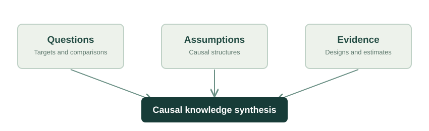

::: {.hero}

Scientific research program · In development

# Causal Atlas of Ecology

Mapping the causal knowledge embedded in ecological science.

Ecology has produced an extraordinary body of research investigating why natural systems behave as they do. Yet the causal knowledge contained in this literature remains difficult to evaluate, compare, and synthesize. Studies may share variables and terminology while asking different questions, invoking different assumptions, and supporting different inferences.

The **Causal Atlas of Ecology** is a developing research program investigating how ecological studies formulate causal questions, support their claims, and contribute to an accumulating body of causal knowledge.

[Explore the research](research.qmd){.btn .btn-primary} [View development roadmap](development.qmd){.btn .btn-outline-primary}

A research program of the <strong>Behavioral Complexity and Causality Lab</strong> · University of Wyoming

:::

::: {.card-grid}
::: {.research-card}

01 · QUESTIONS

### What are we asking?

Examine how ecological studies formulate and communicate questions about causes, mechanisms, and effects.
:::
::: {.research-card}

02 · IDENTIFICATION

### What can we establish?

Distinguish reported causal interpretations from the assumptions and designs needed to identify effects.
:::
::: {.research-card}

03 · SYNTHESIS

### What can we integrate?

Investigate how causal evidence might be compared across studies with different questions and methods.
:::
:::

## The scientific challenge

A statistical relationship is not automatically an answer to a causal question. Nor do two reported effects necessarily describe the same causal quantity. Meaningful synthesis requires attention to what was asked, what was measured, what assumptions were made, and what the evidence can support.

The Atlas seeks to make these distinctions more explicit and, over time, more systematically examinable across the ecological literature.

::: {.figure}

<figcaption>Conceptual framework: causal knowledge synthesis depends on interpreting questions, assumptions, and evidence together. This is a research vision, not a depiction of an operational atlas.</figcaption>
:::

## A program under development

Initial work focuses on conceptual foundations, systematic evaluation of scientific literature, and approaches for reconstructing and assessing causal claims. The long-term ambition is to develop validated methods that can support broader analysis and synthesis across ecological research.

::: {.status-note}
**Project status.** The Causal Atlas of Ecology is in an early research and methods-development stage. A comprehensive public atlas, validated large-scale dataset, and production search interface have **not** yet been launched. See [Development](development.qmd) for the proposed research phases.
:::

## Explore the program

- [**Vision:**](vision.qmd) Why causal knowledge synthesis requires more than collecting conclusions.
- [**Research:**](research.qmd) The questions and methodological principles guiding the program.
- [**Development:**](development.qmd) The phased path from foundational work to research outputs.
- [**Perspectives:**](perspectives.qmd) Short essays on causal reasoning and ecological inference.
