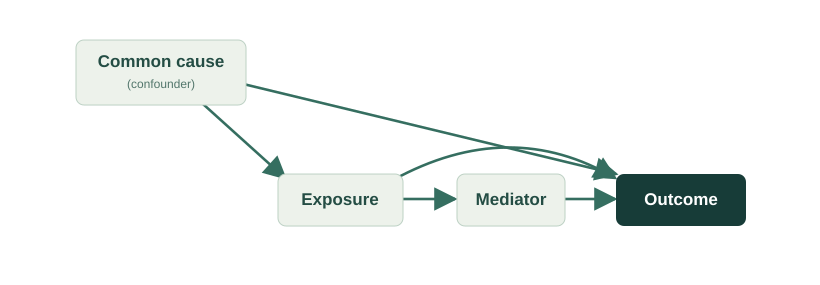

The Causal Atlas of Ecology is organized around four connected lines of inquiry. They define the program's scientific scope without presupposing the outcomes of ongoing research.

## 01 · Causal language and scientific claims

How do ecological papers express questions about causes, effects, and mechanisms? How does the language of a study's motivation compare with its description of methods and its interpretation of results?

This theme examines the relationship between **what a paper appears to ask** and **what its authors claim to have learned**. It recognizes that descriptive, associational, predictive, and causal statements serve different scientific purposes.

## 02 · Causal identification

Under what conditions do study designs and analytical choices support the causal effects being discussed? Which assumptions are stated, which are left implicit, and which may be difficult to assess from a published account?

Identification concerns whether a causal quantity can, in principle, be learned from available evidence under a specified set of assumptions. It is distinct from choosing a statistical model or obtaining a precise estimate.

::: {.figure}

<figcaption>Illustrative causal structure. Arrows express hypothesized causal relationships, not relationships established by data. Different causal questions can require different treatment of the same variables.</figcaption>
:::

## 03 · Causal reconstruction

Can scientific questions, proposed causal structures, and relevant inferential assumptions be reconstructed systematically from published research? How should ambiguity, missing information, and competing interpretations be represented?

This theme considers both the promise and limitations of computational assistance. A reconstructed diagram is an interpretation of reported evidence and assumptions, **not** independent proof of a causal structure.

## 04 · Causal knowledge synthesis

When do results from separate studies address comparable causal quantities? How can differences in context, measurement, population, intervention, and assumptions be made visible during synthesis?

The long-term aim is to move beyond aggregating reported relationships toward evaluating which bodies of evidence can support particular causal questions.

## Methodological commitments

The program is guided by five principles:

1. **Questions before models.** State the scientific question and target causal quantity before interpreting an estimator.
2. **Assumptions made explicit.** Separate causal assumptions from statistical associations and fitted relationships.
3. **Identification before estimation.** Ask whether a target effect is identifiable before debating how precisely it can be estimated.
4. **Uncertainty and ambiguity retained.** Treat incomplete reporting and alternative interpretations as substantive limitations, not details to be silently filled in.
5. **Evaluation and reproducibility.** Subject computational procedures to expert scrutiny, documentation, and validation before making broad empirical claims.

## What this page does not claim

These themes describe an active research agenda. They do not imply that all four lines of inquiry have been completed, that automated reconstruction is fully validated, or that the Atlas currently contains a comprehensive body of identified causal effects.
