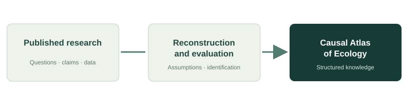
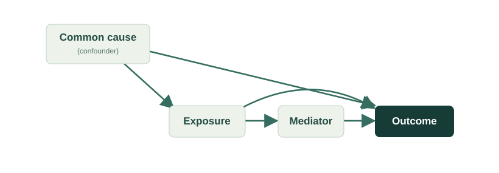

## The challenge of causal synthesis

Ecologists routinely investigate why populations change, species interact, communities assemble, and ecosystems respond to disturbance. Their studies contribute observations, experiments, statistical estimates, predictions, and explanations. Yet synthesizing these contributions as **causal knowledge** requires more than collecting the relationships they report.

Studies may examine similarly named variables while addressing different interventions, outcomes, populations, timescales, or causal pathways. Even when authors use comparable causal language, the assumptions supporting their interpretations may differ. An apparent consensus in reported associations does not necessarily constitute agreement about an identifiable causal effect.

Conventional reviews and literature-mining systems are valuable for organizing topics, methods, variables, and conclusions. The Causal Atlas of Ecology investigates what additional understanding becomes possible when we systematically examine the **causal questions** studies pose, the **assumptions** their inferences require, and the **evidence** they provide.

## Our research vision

The Causal Atlas of Ecology aims to develop systematic, reproducible approaches for interpreting, evaluating, and synthesizing causal knowledge from published ecological research.

By combining causal inference with computational methods, including large language models (LLMs) and independent human evaluation, the program seeks to examine how scientific claims are expressed, how causal conclusions are supported, and when findings across studies are meaningfully comparable.

Over time, validated methods could support structured representations of causal questions, relationships, assumptions, and evidence, enabling new forms of scientific comparison and synthesis.

::: {.figure}

<figcaption>Long-term research vision. The diagram illustrates conceptual stages, not an implemented end-to-end system.</figcaption>
:::

## Research questions

The program is organized around four connected lines of inquiry. These define its scientific scope without presupposing the outcomes of ongoing research.

## 01 | Causal language and scientific claims

How do ecological papers express questions about causes, effects, and mechanisms? How does the language motivating a study compare with its description of methods and interpretation of results?

This theme examines the relationship between **what a paper appears to ask** and **what its authors claim to have learned**. It recognizes that descriptive, associational, predictive, and causal statements serve different scientific purposes.

Computational approaches, including LLM-assisted extraction and classification, offer opportunities to investigate these distinctions systematically. Independent human annotation and validation are essential for evaluating their reliability.

## 02 | Causal identification

Under what conditions do study designs and analytical choices support the causal effects being discussed? Which assumptions are stated, which remain implicit, and which may be difficult to assess from a published account?

Causal identification concerns whether a target causal quantity can, in principle, be learned from available evidence under specified assumptions. It is distinct from selecting a statistical model, estimating parameters, or achieving high predictive accuracy.

::: {.figure}

<figcaption>Illustrative causal structure. Arrows represent hypothesized causal relationships, not relationships established by data. Different causal questions may require different treatment of the same variables.</figcaption>
:::

## 03 | Causal reconstruction

Can scientific questions, proposed causal structures, and relevant inferential assumptions be reconstructed systematically from published research? How should ambiguity, missing information, and competing interpretations be represented?

This theme investigates the potential and limitations of computational assistance in reconstructing causal models from scientific literature. A reconstructed causal diagram represents an interpretation of reported evidence and assumptions, **not independent proof of the underlying causal structure**.

## 04 | Causal knowledge synthesis

When do results from separate studies address comparable causal quantities? How can differences in context, measurement, population, intervention, and assumptions be made visible during synthesis?

The long-term aim is to move beyond aggregating reported relationships, some of which may be spurious or causally misleading, toward evaluating which bodies of evidence can support particular causal questions.

This approach could reveal where independent studies provide convergent causal evidence, where apparent agreement conceals incompatible assumptions, and where important gaps in causal understanding remain.

## Methodological commitments

The program is guided by five core principles:

1. **Ask estimand-aware questions before building models.** Define the scientific question and target causal quantity (estimand) before selecting analytical methods or interpreting model outputs.

2. **Make causal assumptions explicit.** Distinguish assumptions about the data-generating process from observed statistical associations and fitted relationships.

3. **Establish causal identification before estimation.** Determine whether a target causal effect is identifiable under the proposed assumptions before evaluating estimation methods, precision, or statistical significance.

4. **Be transparent about uncertainty and causal ambiguity.** Treat incomplete reporting, competing causal explanations, and unresolved assumptions as substantive limitations rather than details to be overlooked.

5. **Prioritize transparency, reproducibility, and validation.** Document computational procedures, evaluate AI-generated classifications against independent human judgments, and subject methodological conclusions to critical scrutiny.

## Why begin with ecology?

Ecological systems are complex, interconnected, and dynamic. Their study combines experiments, observations, longitudinal measurements, comparative designs, and models across spatial and temporal scales. Ecologists also confront substantial inferential challenges, including confounding, feedback, imperfect measurement, selection bias, and context-dependent effects.

These characteristics make ecology an especially informative setting for investigating how scientific questions, causal assumptions, analytical decisions, and evidence shape scientific conclusions.

## Potential beyond ecology

Although ecology is the program's initial focus, the underlying questions are relevant to other disciplines seeking to infer causes from heterogeneous bodies of evidence.

Methods developed through the Causal Atlas could eventually inform causal knowledge synthesis in environmental science, medicine, public health, and other research fields. Any extension would require domain-specific adaptation, methodological evaluation, and independent validation.
