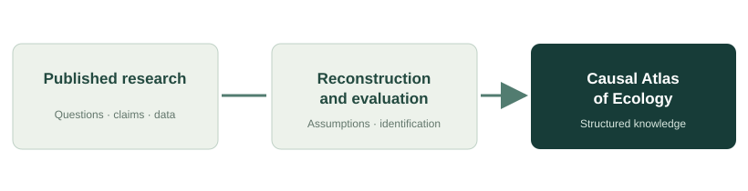

## The challenge of causal synthesis

Ecologists routinely investigate why populations change, species interact, communities assemble, and ecosystems respond to disturbance. Their studies contribute observations, experiments, statistical estimates, predictions, and explanations. But synthesizing these contributions as **causal knowledge** is more demanding than collecting the relationships they report.

Studies can examine similarly named variables yet address different interventions, outcomes, populations, timescales, or causal pathways. Even when authors use comparable causal language, the assumptions supporting their interpretations may differ. An apparent consensus in reported associations need not constitute agreement about an identifiable causal effect.

## A missing dimension in the literature

Conventional reviews and literature-mining systems are valuable for organizing topics, methods, variables, and conclusions. The Causal Atlas of Ecology asks what additional understanding becomes possible when we also attend to the **causal question** a study poses, the **assumptions** its inference requires, and the **evidence** it provides.

This is not a claim that existing ecological studies lack value. Rather, it is an invitation to examine more carefully which kinds of knowledge each study contributes, where uncertainty remains, and when findings are meaningfully comparable.

## Our long-term vision

The program aims to develop systematic, reproducible approaches for interpreting and evaluating causal knowledge in published ecological research. Over time, validated methods could support structured representations of causal questions, assumptions, and evidence, enabling new kinds of comparison and synthesis across studies.

::: {.figure}

<figcaption>Long-term research vision. The diagram illustrates conceptual stages, not an implemented end-to-end system.</figcaption>
:::

## Why begin with ecology?

Ecological systems are complex, interconnected, and dynamic. Their study combines experiments, observations, longitudinal measurements, comparative designs, and models across scales. Ecologists also confront familiar inferential challenges: confounding, feedback, imperfect measurement, selection, and context-dependent effects.

These characteristics make ecology an especially informative setting for investigating the relationship between scientific questions, causal assumptions, analytical decisions, and conclusions.

## Potential beyond ecology

Although ecology is the program's initial focus, the underlying questions are relevant to many disciplines that attempt to infer causes from heterogeneous bodies of evidence. Any extension beyond ecology would require domain-specific evaluation, methodological adaptation, and independent validation.

::: {.status-note}
**Scope note.** The Atlas is a research program, not presently a complete database of ecological causal relationships. Its long-term form will depend on what the development and validation phases establish.
:::
